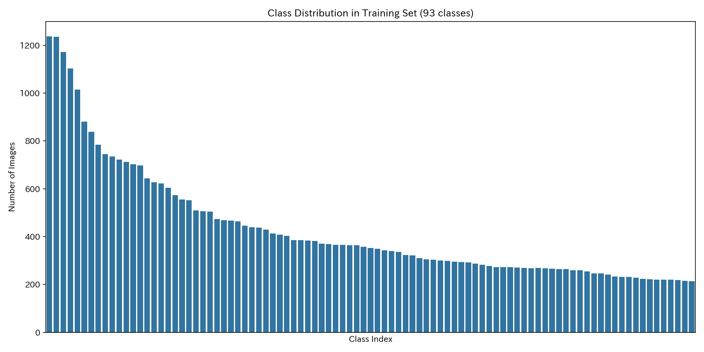
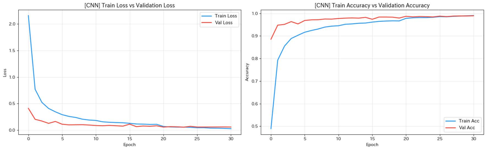
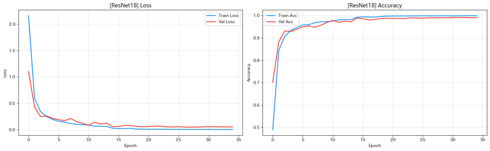

# Hệ Thống Nhận Dạng Chữ Kanji Viết Tay
Dự án thị giác máy tính và học sâu (end-to-end) nhận dạng chữ Hán (Kanji) viết tay tiếng Nhật, xây dựng các kiến trúc mạng nơ-ron huấn luyện từ đầu (from scratch) và ứng dụng web demo tương tác cục bộ.

[🇬🇧 English Version](README.md)

[](https://www.python.org/)
[](https://www.tensorflow.org/)
[](https://pytorch.org/)
[](https://flask.palletsprojects.com/)
[](#6-kết-quả-thực-nghiệm--so-sánh-chuyên-sâu)

<p align="center">
  
  <br>
  <em>Giao diện Web tương tác: Dự đoán song song và xếp hạng Top-3 ứng viên theo thời gian thực trên ký tự 時 (Thời - Thời gian).</em>
</p>

---

## 1. Tổng Quan

Bài toán nhận dạng chữ Kanji viết tay gặp nhiều thách thức lớn do số lượng ký tự khổng lồ, cấu trúc nét phức tạp và độ biến dạng chữ viết tay cao, đặc biệt là phong cách thảo thư/thư pháp cổ (Kuzushiji). Nhiều ký tự có cùng bộ thủ rất dễ bị nhầm lẫn khi người dùng viết nhanh hoặc lướt nét.

Repository này bao quát toàn bộ quy trình phát triển học máy:
- **Xử lý dữ liệu (Dataset Engineering):** Lọc lớp ký tự, phân chia phân tầng (stratified split), và pipeline chuyển đổi cực màu nét vẽ thích ứng giữa Canvas người dùng và tập huấn luyện.
- **Xây dựng mô hình từ đầu (Trained from Scratch):**
  - Mô hình **Custom CNN** gồm 4 khối tích chập, thiết kế để suy luận nhanh với bộ nhớ gọn nhẹ.
  - Mô hình **ResNet-18** tùy biến tự lập trình khối Residual (Skip Connection) nhằm triệt tiêu hiện tượng suy giảm gradient mà không sử dụng trọng số tiền huấn luyện (pre-trained weights).
  - So sánh đối chiếu toàn diện với mô hình **ResNet-18 cơ sở trước đó** (Previous ResNet-18) để kiểm chứng hiệu quả tối ưu hóa.
- **Triển khai ứng dụng cục bộ:** Backend Flask phục vụ suy luận tuần tự cả hai mô hình, trả kết quả về giao diện HTML5 Canvas thời gian thực để so sánh trực quan.

---

## 2. Tính Năng Nổi Bật

- **Huấn luyện từ đầu (From Scratch):** Cả hai mô hình chính (CNN và ResNet-18) đều được thiết kế và huấn luyện không dùng Transfer Learning, nhằm đánh giá chuẩn xác năng lực học đặc trưng hình học của từng kiến trúc.
- **Hiệu năng vượt trội so với nghiên cứu cơ sở:** Mô hình ResNet-18 đề xuất đạt độ chính xác **98.73%** trên 100 lớp, vượt qua mô hình ResNet18 trước đó (**98.27%** trên 92 lớp) với độ mất mát giảm từ **0.0672 xuống 0.0556**.
- **Tiền xử lý đảo cực màu thích ứng (Adaptive Stroke Polarity):** Tự động phát hiện độ tương phản và đảo màu nét vẽ từ Canvas (nét đen trên nền trắng) về định dạng của tập huấn luyện (nét trắng trên nền đen).
- **Suy luận đối sánh hai mô hình (Dual-Model Inference):** Một lần vẽ của người dùng được suy luận tuần tự qua cả CNN và ResNet-18, hiển thị ký tự Top-1, độ tự tin (confidence score) và phân phối Top-3 ứng viên.
- **Xử lý mất cân bằng lớp:** Ứng dụng trọng số nghịch đảo tần suất lớp trong PyTorch giúp mô hình nhận dạng chuẩn xác cả những lớp có ít dữ liệu.
- **Giao diện Web tương tác:** Canvas vẽ HTML5 ($400 \times 400$) hỗ trợ chuột và màn hình cảm ứng, có lưới trợ nét chữ điền, tùy chỉnh cỡ nét cọ (2px–20px) và nút chuyển đổi giao diện Sáng / Tối.

---

## 3. Kiến Trúc Hệ Thống & Luồng Dữ Liệu

```
┌───────────────────────────────────────────────────────────────────────────┐
│                           CLIENT (Giao diện Web)                          │
│  Người dùng vẽ trên Canvas (400x400) -> Xuất dữ liệu ảnh Base64 PNG       │
└─────────────────────────────────────┬─────────────────────────────────────┘
                                      │ HTTP POST /predict { image: base64 }
                                      ▼
┌───────────────────────────────────────────────────────────────────────────┐
│                           FLASK BACKEND (app.py)                          │
│                                                                           │
│  1. Giải mã chuỗi Base64 -> Ảnh xám PIL Grayscale ('L')                   │
│  2. Kiểm tra cực màu: if mean(pixel) > 127 => đảo màu (255 - pixel)       │
│  3. Thu phóng bằng thuật toán Lanczos về kích thước chuẩn 64x64           │
│  4. Chuẩn hóa giá trị điểm ảnh về khoảng thực [0.0, 1.0]                  │
│                                                                           │
│  Suy luận tuần tự hai mô hình:                                            │
│  ├── Reshape về (1, 64, 64, 1) -> Custom CNN -> Kết quả Top-1 & Top-3     │
│  └── Nhân bản lên (1, 64, 64, 3) -> ResNet-18  -> Kết quả Top-1 & Top-3   │
│                                                                           │
│  Trả về JSON: { cnn: { top1, confidence, top3 }, resnet: { ... } }        │
└─────────────────────────────────────┬─────────────────────────────────────┘
                                      │ Phản hồi JSON
                                      ▼
┌───────────────────────────────────────────────────────────────────────────┐
│                           TRỰC QUAN HÓA KẾT QUẢ                           │
│  Thẻ so sánh song song với thanh phần trăm độ tự tin & bảng xếp hạng Top-3│
└───────────────────────────────────────────────────────────────────────────┘
```

---

## 4. Tập Dữ Liệu & Tiền Xử Lý

Thực nghiệm sử dụng tập dữ liệu nguồn mở chuẩn học thuật **Kuzushiji-Kanji** (ROIS-DS CODH):

- **Tập dữ liệu thô đầy đủ:** Chứa 2,472 lớp ký tự Unicode với mức độ mất cân bằng tần suất xuất hiện rất lớn.
- **Tập dữ liệu chuẩn 100 lớp (`100class/`):**
  - **Số lớp:** 100 lớp ký tự có tần suất xuất hiện cao và tiêu biểu.
  - **Tổng số mẫu:** 29,365 ảnh xám.
  - **Phân chia tập:** Chia ngẫu nhiên phân tầng (Stratified split) thành tập Huấn luyện (70% — 20,555 ảnh), tập Kiểm định (15% — 4,405 ảnh), và tập Kiểm thử độc lập (15% — 4,405 ảnh).
- **Tập dữ liệu nghiên cứu cơ sở trước đó:**
  - Tập con gồm 92 lớp (các lớp chứa $\ge 300$ ảnh).
  - Thường chỉ được huấn luyện sơ bộ trong 15 epoch trên CPU.

<p align="center">
  
  <br>
  <em>Hình 1: Đồ thị phân bố tần suất dạng đuôi dài (long-tailed distribution) trên các lớp của tập dữ liệu. Số lượng mẫu sụt giảm mạnh từ >1,200 ảnh xuống chỉ còn ~210 ảnh, minh chứng cho bài toán mất cân bằng lớp cần giải quyết bằng Weighted Loss.</em>
</p>

### Quy trình Tiền Xử Lý & Tăng Cường Dữ Liệu
1. **Thích ứng cực màu nét vẽ (Polarity Adaptation):**
   Dữ liệu huấn luyện lưu trữ nét chữ màu trắng trên nền đen ($\text{mean} < 127$). Ngược lại, nét vẽ trên Canvas web là nét đen trên nền trắng ($\text{mean} > 127$). Backend tự động xử lý:
   $$\text{img} = 255 - \text{img} \quad \text{nếu} \quad \frac{1}{HW}\sum_{i,j} \text{img}_{i,j} > 127$$
2. **Thu phóng (Resizing):** Sử dụng thuật toán nội suy Lanczos về $64 \times 64$ pixels.
3. **Chuẩn hóa (Normalization):** Đưa khoảng giá trị pixel về $[0.0, 1.0]$.
4. **Tăng cường dữ liệu (Data Augmentation):**
   - Xoay ngẫu nhiên: $\pm 10^\circ$
   - Dịch chuyển ngẫu nhiên: $\pm 10\%$ theo chiều ngang và dọc
   - Thu phóng ngẫu nhiên (Zoom): $\pm 10\%$

---

## 5. Kiến Trúc Các Mô Hình

Ba cấu hình mô hình chính trong đề tài:

### 1. Custom CNN (`training/CNN.ipynb`)
- **Framework:** TensorFlow / Keras
- **Kích thước đầu vào:** $(64, 64, 1)$ — Ảnh xám đơn kênh
- **Cấu trúc:**
  - 4 khối tích chập lặp lại, mỗi khối gồm $2 \times \text{Conv2D}(3 \times 3)$, Batch Normalization, hàm kích hoạt ReLU, Max Pooling $2 \times 2$, và Spatial Dropout 25%.
  - Tiến trình số lượng kênh: $32 \rightarrow 64 \rightarrow 128 \rightarrow 256$.
  - Khối phân loại: `Flatten` $\rightarrow$ `Dense(512)` $\rightarrow$ `BatchNorm` $\rightarrow$ `ReLU` $\rightarrow$ `Dropout(0.5)` $\rightarrow$ `Dense(100, softmax)`.
- **Tổng số tham số:** 3,326,532 (~3.3 triệu)

### 2. Proposed ResNet-18 (`training/RESNET18.ipynb`)
- **Framework:** TensorFlow / Keras (tự xây dựng từ đầu)
- **Kích thước đầu vào:** $(64, 64, 3)$ — Ảnh xám nhân bản thành 3 kênh
- **Cấu trúc:**
  - Lớp tích chập đầu vào kèm Batch Normalization, ReLU và Max Pooling.
  - 4 stage phần dư với số bộ lọc $[64, 128, 256, 512]$, mỗi stage gồm 2 khối Residual Block chứa đường tắt đồng nhất (Identity Shortcut) hoặc đường tắt chiếu tích chập $1 \times 1$ (Projection Shortcut) khi giảm kích thước không gian.
  - Lớp gộp trung bình toàn cục (Global Average Pooling) nối vào lớp Dense 100 ngõ ra Softmax.
- **Tổng số tham số:** 11,229,732 (~11.2 triệu)

### 3. Previous ResNet-18 Baseline (`training/training_notebook.ipynb`)
- **Framework:** PyTorch (chạy trên CPU)
- **Số lớp:** 92 lớp
- **Cấu hình huấn luyện:** 15 epochs, trọng số lớp nghịch đảo tần suất $w_c = \frac{N}{K \cdot N_c}$.

---

## 6. Kết Quả Thực Nghiệm & So Sánh Chuyên Sâu

### 6.1. Bảng Tổng Hợp Kết Quả Hai Mô Hình Đề Xuất
Các chỉ số dưới đây được trích xuất trực tiếp từ Bảng kết quả tổng hợp (Table 2 & 3 trong báo cáo nghiệm thu):

| Chỉ số đánh giá | Custom CNN (Keras) | Proposed ResNet-18 (Keras) | Nhận xét so sánh |
| :--- | :---: | :---: | :--- |
| **Số lớp mục tiêu** | 100 lớp | 100 lớp | Cùng đánh giá trên 100 lớp |
| **Kích thước tập Test** | 4,405 mẫu | 4,405 mẫu | Tập kiểm thử độc lập hoàn toàn |
| **Độ chính xác (Accuracy)** | **98.52%** | **98.73%** | ResNet-18 vượt trội hơn +0.21% |
| **Độ mất mát (Test Loss)** | 0.0597 | **0.0556** | ResNet-18 có loss thấp hơn rõ rệt |
| **Precision (%)** | 98.39% | **98.64%** | ResNet-18 phân loại chuẩn xác hơn |
| **Recall (%)** | 98.26% | **98.45%** | ResNet-18 có độ bao phủ cao hơn |
| **Macro Average F1** | 98.29% | **98.52%** | Cân bằng hiệu năng trên toàn bộ 100 lớp |
| **Tổng số tham số** | **3,326,532 (3.3M)** | 11,229,732 (11.2M) | CNN nhẹ hơn 3.3 lần |
| **Thời gian huấn luyện** | **8.5 phút** | 44.0 phút | CNN train nhanh hơn 5.2 lần |
| **Số Epoch thực tế** | 31 (Early stop tại 24) | 35 (Early stop tại 28) | Cả hai đều hội tụ sớm nhờ scheduler |
| **Dung lượng file Model** | **38.2 MB** | 128.7 MB | CNN tối ưu cho bộ nhớ nhỏ |

---

### 6.2. So Sánh Đối Chiếu Với Nghiên Cứu ResNet-18 Trước Đó
Dựa trên đối chiếu thực nghiệm giữa mô hình ResNet-18 của đề tài và nghiên cứu ResNet-18 cơ sở trước đó:

| Tiêu chí | Previous ResNet-18 (Mô hình cũ) | Proposed ResNet-18 (Đề tài hiện tại) | Cải tiến đạt được |
| :--- | :---: | :---: | :--- |
| **Số lớp phân loại** | 92 lớp | **100 lớp** | **Mở rộng thêm 8 lớp phức tạp** |
| **Số Epoch huấn luyện** | 15 epochs (CPU) | **35 epochs** (Early Stopping) | Huấn luyện sâu hơn, hội tụ triệt để |
| **Độ mất mát (Test Loss)** | 0.0672 | **0.0556** | **Giảm 17.3%** mất mát (tổng quát hóa tốt hơn) |
| **Độ chính xác (Accuracy)** | 98.27% | **98.73%** | **Tăng +0.46%** |
| **Macro F1-Score** | 98.07% | **98.52%** | **Tăng +0.45%** |

#### Phân tích nguyên nhân vượt trội:
1. **Không gian phân loại rộng hơn nhưng độ chính xác cao hơn:** Thông thường khi mở rộng từ 92 lên 100 lớp, ranh giới phân lớp sẽ trở nên phức tạp hơn và dễ phát sinh nhầm lẫn. Tuy nhiên, ResNet-18 đề xuất vẫn đạt kết quả vượt trội ở cả 3 chỉ số then chốt (Accuracy, Loss, Macro F1).
2. **Chiến lược huấn luyện sâu kết hợp tối ưu hóa hiện đại:** Mô hình cũ chỉ huấn luyện 15 epoch dẫn đến việc chưa khai thác hết năng lực học biểu diễn. Đề tài mở rộng số epoch lên 35-50 epoch kết hợp cùng bộ điều chỉnh tốc độ học `ReduceLROnPlateau` và Early Stopping, giúp trọng số hội tụ sâu vào điểm cực tiểu tối ưu.
3. **Pipeline tiền xử lý và tăng cường dữ liệu bài bản:** Thuật toán thích ứng cực màu kết hợp các phép biến dạng xoay/dịch/zoom ngẫu nhiên giúp mạng học được tính bất biến đối với các dị thể chữ viết tay, cải thiện trực tiếp khả năng dự đoán trên dữ liệu chưa từng thấy.

---

### 6.3. Quá Trình Huấn Luyện & Đồ Thị Hội Tụ

<p align="center">
  
  <br>
  <em>Hình 2: Tiến trình huấn luyện Custom CNN qua 31 epoch. Loss giảm đều đặn từ >2.1 xuống 0.03, độ chính xác tập kiểm định (Val Acc) ổn định quanh 98.5% và không xuất hiện khoảng cách quá khớp (overfitting).</em>
</p>

<p align="center">
  
  <br>
  <em>Hình 3: Tiến trình huấn luyện Custom ResNet-18 qua 35 epoch. Các đường tắt phần dư giúp hội tụ nhanh chóng, đạt 99.9% Train Accuracy và 98.73% Test Accuracy.</em>
</p>

---

### 6.4. Đánh Đổi Hiệu Năng & Tài Nguyên (Trade-Off Analysis)
- **Về độ chính xác:** ResNet-18 là lựa chọn số 1 khi ưu tiên chất lượng nhận dạng tối đa, nhất là với các chữ Hán cổ nhiều nét mảnh, nét chồng chéo.
- **Về tài nguyên triển khai:** Custom CNN là lựa chọn vượt trội cho môi trường biên (Edge Devices, Mobile, Embedded):
  - Kích thước mô hình nhỏ hơn **3.3 lần** (38.2 MB so với 128.7 MB).
  - Tốc độ huấn luyện nhanh hơn **5.2 lần** (8.5 phút so với 44.0 phút).
  - Tiêu thụ ít bộ nhớ RAM và CPU/GPU trong quá trình suy luận thời gian thực.

---

## 7. Phân Tích Ma Trận Nhầm Lẫn (Confusion Matrix)

Dựa trên phân tích Normalized Confusion Matrix trên **Top 20 lớp ký tự có tỷ lệ nhầm lẫn cao nhất** từ báo cáo nghiệm thu:

1. **Hiệu năng trên đường chéo chính (True Positive Rates):**
   - **Custom CNN:** Các giá trị dự đoán đúng trên đường chéo chính dao động trong khoảng **0.85 đến 0.97**.
   - **Proposed ResNet-18:** Đạt mật độ tập trung cao và ổn định hơn rõ rệt, dao động từ **0.93 đến 0.97**.
2. **Triệt tiêu các sai số ngoài đường chéo (Off-diagonal Confusion):**
   - Ở Custom CNN, một số cặp ký tự phức tạp xuất hiện tỷ lệ nhầm lẫn đáng kể từ **0.04 đến 0.15** (4%–15%).
   - Ở ResNet-18, các giá trị nhầm lẫn ngoài đường chéo này giảm xuống mức tối thiểu (< 0.02) hoặc bị triệt tiêu hoàn toàn.
3. **Các nguyên nhân nhầm lẫn thị giác chính:**
   - **Cấu trúc bộ thủ tương đồng:** Ví dụ chữ **今** (Kim - Nay) và chữ **分** (Phân - Chia) cùng mang bộ "Nhân nón" ($\boldsymbol{\hat{人}}$) ở đỉnh.
   - **Lược nét trong chữ thảo Kuzushiji:** Ví dụ chữ **國** (Quốc) trong thư pháp cổ thường bị giản lược thành nét xoắn đơn giản, gây nhầm lẫn với chữ **人** (Nhân).
   - **Cụm chữ chung bộ Thủy `氵`:** Các chữ như 海 (Hải), 汁 (Trấp), 江 (Giang) đôi khi bị hoán đổi vị trí giữa Top-1 và Top-2, nhưng luôn nằm chắc chắn trong **Top-3**.

---

## 8. Web Demo Tương Tác & Các Tình Huống Thực Nghiệm

Ứng dụng Web demo đóng vai trò kiểm thử trực quan trên nét vẽ tay tự do của người dùng. Dưới đây là 5 ca thực nghiệm đại diện được trích xuất từ phiên bản demo trực tiếp:

### Ca 1: Nhận diện chuẩn xác với độ tự tin tuyệt đối — 時 (Thời)
<p align="center">
  
</p>

- **Đầu vào:** Nét chữ **時** (Thời gian - cấu tạo từ 日 + 寺).
- **Kết quả:** Cả hai mô hình đều đưa ra dự đoán dứt khoát với độ tự tin cực cao: **Custom CNN đạt 100%**, và **ResNet-18 đạt 99%**. Phân phối xác suất các ứng viên phía sau đều tiệm cận 0%.

---

### Ca 2: Họ bộ thủ tương đồng & Xếp hạng ứng viên — 木 (Mộc)
<p align="center">
  
</p>

- **Đầu vào:** Ký tự 4 nét **木** (Cây/Gỗ) được vẽ bằng cỡ nét bút dày (16px).
- **Kết quả:** Cả hai mô hình đều nhận diện chính xác **木** ở Top-1 (CNN: 93%, ResNet: 59%). Đáng chú ý, các ứng viên Top-3 nắm bắt trọn vẹn các chữ có chung cấu trúc gốc mộc: **本** (Bản, 7%) và **来** (Lai), thể hiện không gian đặc trưng có tính gom cụm ngữ nghĩa thị giác chặt chẽ.

---

### Ca 3: Trích xuất đặc trưng bộ thủ phức tạp — 近 (Cận)
<p align="center">
  
</p>

- **Đầu vào:** Ký tự **近** (Gần) gồm bộ Quai xước 辶 bao quanh chữ 斤.
- **Kết quả:** Custom CNN đạt độ tự tin **98%**, ResNet-18 đạt **95%**. Ký tự ở vị trí #2 là **道** (Đạo - cũng mang bộ Quai xước 辶), chứng minh mạng học rất tốt các đặc trưng cục bộ của bộ thủ.

---

### Ca 4: Đối sánh kiến trúc trên ký tự nhiều nét dày đặc — 春 (Xuân)
<p align="center">
  
</p>

- **Đầu vào:** Ký tự **春** (Mùa xuân) có 9 nét với nhiều nét ngang song song và bộ Nhật 日 ở dưới.
- **Kết quả phân tích:**
  - **Custom CNN gặp khó:** Bị nhầm lẫn bởi các nét ngang dày đặc, đoán sai thành chữ **書** (Thư - 39%), đẩy chữ **春** xuống vị trí #2 (21%) và **蚕** ở #3 (15%).
  - **ResNet-18 vượt trội:** Nhận diện chính xác chữ **春 với độ tự tin áp đảo 97%**!
- **Ý nghĩa kỹ thuật:** Đây là bằng chứng trực quan rõ rệt nhất về ưu thế của ResNet-18. Các đường tắt Residual giữ nguyên thông tin không gian chi tiết qua nhiều tầng sâu, không bị nhòe nét như mạng CNN thuần khi đối mặt với chữ có mật độ nét cao.

---

### Ca 5: Phân biệt nét tinh vi giữa các chữ gần giống — 松 (Tùng)
<p align="center">
  
</p>

- **Đầu vào:** Chữ **松** (Cây thông - cấu tạo từ 木 + 公).
- **Kết quả:** Cả hai mô hình đều đưa ra dự đoán Top-1 chính xác cho **松** (CNN: 92%, ResNet: 95%). Ở vị trí #3 xuất hiện chữ **私** (Tư - cấu tạo từ 禾 + 厶), phản ánh độ nhạy bén của mô hình khi nhận biết ranh giới mỏng manh giữa bộ Mộc (木) và bộ Hòa (禾).

---

## 9. Cấu Trúc Thư Mục Repository

```
├── assets/                        # Thư mục chứa hình ảnh trực quan hóa
│   ├── class_distribution.png     # Đồ thị phân bố mẫu đuôi dài (93 lớp)
│   ├── CNN.png                    # Đồ thị loss và accuracy của Custom CNN
│   ├── REsnet18.png               # Đồ thị loss và accuracy của ResNet-18
│   ├── Screenshot 2026-10-24 205057.png  # Web demo: nhận diện chữ 時 (Thời)
│   ├── Screenshot 2026-10-24 210531.png  # Web demo: nhận diện chữ 木 (Mộc)
│   ├── Screenshot 2026-10-24 210942.png  # Web demo: nhận diện chữ 近 (Cận)
│   ├── Screenshot 2026-10-24 211153.png  # Web demo: đối sánh trên chữ 春 (Xuân)
│   └── Screenshot 2026-10-24 211441.png  # Web demo: phân biệt chữ 松 (Tùng)
│
├── demo/
│   ├── app.py                     # Flask server xử lý tiền xử lý & suy luận tuần tự
│   ├── requirements.txt           # Danh sách thư viện Python cần thiết cho demo
│   ├── frontend/
│   │   ├── index.html             # Giao diện web chính với các thẻ hiển thị đối sánh
│   │   ├── script.js              # Logic thao tác Canvas, mã hóa Base64 & gọi API
│   │   └── style.css              # Giao diện hiện đại, hỗ trợ chế độ Dark/Light mode
│   ├── label/
│   │   ├── labelscnn.json         # Danh mục 100 nhãn cho Custom CNN (1 kênh)
│   │   └── labelsresnet18.json    # Danh mục 100 nhãn cho ResNet-18 (3 kênh)
│   └── model/
│       └── .gitkeep               # Giữ thư mục trên Git (weights được bỏ qua bởi .gitignore)
│
├── training/
│   ├── CNN.ipynb                  # Notebook huấn luyện & đánh giá Custom CNN 100 lớp
│   ├── RESNET18.ipynb             # Notebook huấn luyện & đánh giá ResNet-18 100 lớp
│   └── training_notebook.ipynb    # Notebook PyTorch huấn luyện 92/93 lớp kèm Weighted Loss
│
├── .gitignore                     # Cấu hình bỏ qua dataset, file binary nặng và file tạm
├── README.md                      # Tài liệu dự án bằng Tiếng Anh
└── README_VI.md                   # Tài liệu dự án bằng Tiếng Việt
```

---

## 10. Hướng Dẫn Cài Đặt & Chạy Cục Bộ

### Yêu cầu môi trường
- Python 3.10, 3.11, hoặc 3.12
- Trình quản lý gói `pip`

### 1. Sao chép (Clone) kho lưu trữ
```bash
git clone https://github.com/<tai-khoan-cua-ban>/kanji-handwriting-recognition.git
cd kanji-handwriting-recognition
```

### 2. Thiết lập môi trường ảo
```bash
# Tạo môi trường ảo
python -m venv .venv

# Kích hoạt trên Windows:
.venv\Scripts\activate

# Kích hoạt trên Linux/macOS:
source .venv/bin/activate
```

### 3. Cài đặt các thư viện cần thiết
```bash
pip install -r demo/requirements.txt
```

*Nội dung file `demo/requirements.txt`:*
```
flask>=3.0.0
flask-cors>=4.0.0
tensorflow>=2.15.0
numpy>=1.24.0
Pillow>=10.0.0
```

### 4. Chuẩn bị file trọng số mô hình
Do file `model_resnet18.h5` nặng ~128.7 MB vượt giới hạn 100 MB của GitHub, các file trọng số không được commit trực tiếp vào git.

Hãy đặt file trọng số đã huấn luyện vào thư mục `demo/model/`:
- `demo/model/model_cnn.h5`
- `demo/model/model_resnet18.h5`

*(Bạn có thể tự xuất các file này bằng cách chạy các cell lưu model trong notebook `training/CNN.ipynb` và `training/RESNET18.ipynb`, hoặc tải về từ mục **Releases** của repo nếu có).*

### 5. Khởi chạy máy chủ Web
```bash
cd demo
python app.py
```

Mở trình duyệt web và truy cập địa chỉ:
```
http://localhost:5000
```

### 6. Kiểm tra trạng thái máy chủ
Bạn có thể kiểm tra API bằng lệnh:
```bash
curl http://localhost:5000/status
```
Kết quả phản hồi mẫu:
```json
{
  "server": "running",
  "cnn_model": "loaded",
  "resnet_model": "loaded",
  "cnn_labels": "loaded",
  "resnet_labels": "loaded"
}
```

---

## 11. Ghi Chú Kỹ Thuật & Xử Lý Sự Cố

- **Xử lý tương thích Keras Colab:** Các model lưu từ môi trường Google Colab mới thường chứa khóa `quantization_config` trong cấu hình layer. Khi nạp lại trên các bản Keras local cũ hơn, hàm `load_model()` sẽ báo lỗi `TypeError`. File `demo/app.py` đã tích hợp sẵn đoạn monkey-patch loại bỏ thuộc tính này trước khi khởi tạo `Dense`, giúp nạp model trơn tru trên mọi phiên bản.
- **Thực thi suy luận tuần tự:** Server thực hiện suy luận trên mô hình CNN trước, sau đó tiếp tục suy luận trên ResNet-18 trong cùng một chu kỳ request. Khi triển khai production chịu tải lớn, có thể chuyển sang cơ chế suy luận bất đồng bộ hoặc hàng đợi worker.
- **Trùng cổng mạng (Port Conflict):** Nếu cổng 5000 đã bị chiếm dụng bởi ứng dụng khác, bạn có thể chỉnh sửa dòng cuối cùng của `demo/app.py`:
  ```python
  app.run(host='0.0.0.0', port=5001, debug=False)
  ```

---

## 12. Các Giới Hạn Hiện Tại

- **Chỉ nhận dạng từng chữ đơn lẻ:** Hệ thống hiện chỉ nhận ảnh một chữ Kanji vẽ đơn lẻ, chưa tích hợp thuật toán phân đoạn dòng chữ để đọc cả văn bản dài.
- **Quy mô lớp huấn luyện:** Mô hình hiện được đánh giá trên 100 lớp (và 92 lớp) đại diện, chưa mở rộng ra toàn bộ 2,472+ lớp chữ Hán cổ.
- **Kích thước ảnh cố định:** Thao tác co giãn trực tiếp về $64 \times 64$ có thể làm méo tỷ lệ nét nếu người dùng vẽ chữ lệch sát mép khung Canvas.

---

## 13. Định Hướng Nâng Cấp Tiếp Theo

- [ ] **Mở rộng toàn bộ 2,472 lớp:** Áp dụng phương pháp phân loại phân cấp (Hierarchical Classification) hoặc Metric Learning (ArcFace / CosFace) để học các lớp hiếm mẫu.
- [ ] **Thử nghiệm Vision Transformer (ViT):** Đánh giá các biến thể gọn nhẹ (như MobileViT) để khai thác cơ chế Self-Attention nắm bắt mối tương quan nét vẽ toàn cục.
- [ ] **Nhận dạng theo dòng văn bản:** Kết hợp mô hình phát hiện chữ (như YOLO) cùng mạng **CRNN + CTC Loss** để đọc văn bản viết tay liên tục trên tài liệu cổ.
- [ ] **Tối ưu hóa mô hình & Xuất ONNX:** Chuyển đổi trọng số sang định dạng ONNX / TensorFlow Lite để thực hiện suy luận trực tiếp trên trình duyệt bằng ONNX Runtime Web.

---

## 14. Lời Cảm Ơn & Nguồn Tham Khảo

- **Tập dữ liệu:** Bộ dữ liệu Kuzushiji-Kanji được cung cấp bởi [Center for Open Data in the Humanities (CODH)](http://codh.rois.ac.jp/kmnist/), National Institute of Informatics (ROIS-DS).
- **Cảm hứng đề tài:** Các nghiên cứu về số hóa di sản tài liệu cổ và các chuẩn đánh giá nhận dạng chữ viết tay tiếng Nhật.
